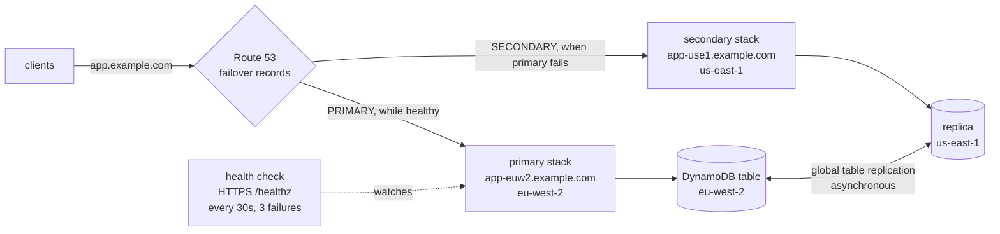

# Multi-region active-passive pattern (Terraform)

A small Terraform module for the data and traffic layers of an
**active-passive** setup across two AWS regions:

- **Data:** a DynamoDB global table, written in the primary region and
  replicated to the secondary region.
- **Traffic:** Route 53 failover records. Clients go to the primary
  endpoint while its health check passes, and to the secondary endpoint
  when it fails.

> **Status:** `terraform validate` plus 6 `terraform test` runs against a
> mocked AWS provider: one apply-with-mocks that checks the replica,
> streams, PITR, failover records and health check wiring, and five
> rejected inputs. The example root validates against a committed lock
> file. **Nothing has been planned or applied in AWS**, so replication lag,
> health check timing and real failover behaviour are untested.

## Problem

> Create an Ansible role or Terraform module that implements multi-region
> active-passive or active-active patterns for a stateful application
> (including data replication).

Why it matters: running in one region means a regional outage takes the
application down with it. Replicating the data and moving traffic on a
failed health check lets the secondary region take over without someone
editing DNS by hand during the incident.

## The pattern



This is the simplest honest version of the pattern. Active-passive avoids
most write-conflict problems because, in normal operation, only one region
takes traffic.

## What the module creates

| Resource | Notes |
|---|---|
| `aws_dynamodb_table` | on-demand billing, streams (`NEW_AND_OLD_IMAGES`, needed by global tables), point-in-time recovery and encryption, one `replica` in `secondary_region` with PITR |
| `aws_route53_health_check` | HTTPS on port 443 to `primary_endpoint` + `health_check_path`, 30 s interval, 3 failures to mark unhealthy |
| `aws_route53_record` x2 | CNAME failover records: `PRIMARY` with the health check, `SECONDARY` without one (so it is used whenever the primary is unhealthy) |

Guards: the replica region must differ from the provider (primary) region,
the two endpoints must differ, the TTL must be 30-300 s, the health path
must start with `/`, and the zone ID must look like a Route 53 zone ID.

## Usage

```hcl
provider "aws" {
  region = "eu-west-2" # primary region
}

module "orders_ha" {
  source = "github.com/zeinhaidara/43-terraform-multiregion-ha-pattern"

  name               = "orders"
  secondary_region   = "us-east-1"
  zone_id            = "Z0123456789EXAMPLE"
  record_name        = "app.example.com"
  primary_endpoint   = "app-euw2.example.com"
  secondary_endpoint = "app-use1.example.com"
}
```

Run the same checks as CI:

```bash
terraform fmt -check -recursive
terraform init -backend=false
terraform validate
terraform test

cd examples/basic
terraform init -backend=false -lockfile=readonly
terraform validate
```

CI fails if `terraform test` reports zero passed runs. Terraform 1.15.8 is
downloaded and checked against a pinned sha256. `hashicorp/aws` is
`>= 6.0, < 7.0` in the module and pinned to `6.73.0` in the example, whose
lock file is the only one committed.

## What this pattern does not cover

- **The application tier.** The two endpoints (load balancers, services,
  compute in each region) must already exist; this module only routes to
  them. The passive stack must be deployed, scaled enough to take traffic,
  and configured to use its local replica.
- **Write conflicts.** DynamoDB global tables replicate asynchronously and
  resolve concurrent writes to the same item with **last writer wins**. That
  is acceptable here only because the passive region shouldn't take writes
  in normal operation. During a failover, writes made in the primary just
  before it failed may not have replicated yet (replication lag, typically
  around a second; AWS behaviour to re-verify), so recent writes can be lost.
- **A controlled failback.** Route 53 fails back **automatically** as soon as
  the primary health check passes again, which can flap traffic between
  regions. A real runbook would pause automatic failback (for example by
  inverting or disabling the health check), verify data, then move traffic
  deliberately. That procedure is not built here.
- **Health check depth.** The check proves the primary endpoint answers
  HTTPS; it doesn't prove the application can read and write its data.
- **Other state** such as caches, queues, object storage, and secrets
  replication.

## Cost drivers

- DynamoDB global tables: **replicated write request units** in the
  secondary region (every write is paid again there), storage in both
  regions, PITR in both regions.
- Cross-region data transfer for replication.
- Route 53: the hosted zone, the health check (HTTPS checks cost more than
  basic ones), and DNS queries.
- The passive application stack, which runs all the time even when idle.

## Security notes

- Table encryption at rest is on, with point-in-time recovery in both
  regions.
- No credentials, state or backend in the repo; IDs are placeholders.
- The health check endpoint is public by necessity (Route 53 checkers probe
  it from the internet). Keep `/healthz` cheap and free of sensitive detail.

## Idempotency

Plain declarative Terraform. Re-applying with the same inputs is a no-op.
Changing `secondary_region` replaces the replica, which re-copies the table.
